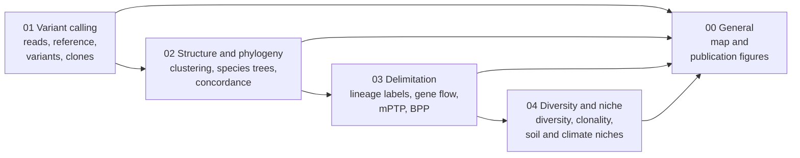

# Phylogeography and cryptic lineages of *Cenococcum geophilum* in Europe

Analysis code for a study of population structure, cryptic lineages and niches of the ectomycorrhizal fungus *Cenococcum geophilum* across Europe.

**Felix Zimmermann**, Swiss Federal Institute for Forest, Snow and Landscape Research WSL, Birmensdorf, Switzerland

> The manuscript is in preparation; scripts may still change until publication. Citation details and data accessions will be added here.

---

## Background

*Cenococcum geophilum* is one of the most widespread and abundant ectomycorrhizal fungi, found on the roots of many tree species from the Arctic to the subtropics. It has never been observed to reproduce sexually, yet it carries both mating-type idiomorphs and is genetically highly diverse, and earlier work suggested that the morphospecies hides several cryptic lineages. How these lineages are distributed, whether they exchange genes and whether they occupy different soil and climate niches is largely unknown.

This repository contains the code that takes whole-genome short reads of several hundred European isolates to:

1. call variants on a reference built from single-copy orthologues;
2. identify clones and describe population structure and phylogeny;
3. delimit lineages with several independent lines of evidence;
4. describe diversity, clonality, recombination and the soil and climate niches of these lineages.

## Sampling

Isolates come from two sampling projects with different designs:

| Project | Sites | Host | Soil sampled |
|---|---|---|---|
| **PhytOakmeter** | *Quercus robur* trees across Europe | oak | four soil pits 5 m from the tree, at 5–10, 25–30 and 45–50 cm |
| **MAGIC** | forest plots in Switzerland | oak and beech | topsoil, 0–10 cm |

*Cenococcum* genome assemblies and isolates and assemblies of the sister genus *Pseudocenococcum* (outgroup) complete the data set.

## Workflow



| Phase | Content | Main tools |
|---|---|---|
| `01_variant_calling` | read trimming and QC; single-copy orthologue reference; mapping, variant calling and filtering; clone identification; sample metadata and mating types | fastp, FastQC, MultiQC, OrthoFinder, MAFFT, trimAl, BWA, SAMtools, BCFtools, PLINK, poppr |
| `02_structure_phylogeny` | call sets for phylogeny and clustering; population clustering; per-gene consensus sequences and alignments; concatenation, coalescent and site-based species trees; site and gene concordance factors; topology tests; monophyly of the clusters | DAPC (adegenet), sNMF (LEA), fineRADstructure, IQ-TREE 2, ASTER, ASTRAL-III, CASTER-site |
| `03_delimitation` | lineage labels at K = 4 to 6; unit trees; Neighbour-Net; recombination (PHI, index of association); gene flow (D, f4-ratio, f-branch); single-locus and multispecies-coalescent delimitation; one table of evidence per lineage | ASTER, fast-nnt, PhiPack, poppr, Dsuite, mPTP, BPP |
| `04_diversity_niche_selection` | nucleotide diversity, divergence and F<sub>ST</sub>; AMOVA; Tajima's D; genotypic diversity and clonality; isolation by distance and relatedness within sites; soil and climate niches (partial RDA, variance partitioning, depth profiles, Bayesian model averaging) | ade4, vegan, lme4, terra (CHELSA climate) |
| `00_general` | sampling map, samples per site and the composite publication figures | ggplot2, ggtree, sf |

## Repository layout

```
.
├── hpc/                          cluster scripts (bash, SLURM)
│   ├── 01_variant_calling/
│   ├── 02_structure_phylogeny/
│   ├── 03_delimitation/
│   └── 04_diversity_niche_selection/
├── local/                        R scripts
│   ├── 00_general/
│   ├── 01_variant_calling/
│   ├── 02_structure_phylogeny/
│   ├── 03_delimitation/
│   └── 04_diversity_niche_selection/
├── LICENSE
└── README.md
```

Scripts are numbered `NNN_topic` within each phase. Every script has the same structure: a header naming each input with the script that produces it, a block of paths and parameters, the analysis steps and a closing list of the files it writes.

## Running the scripts

**Order.** Scripts run in numerical order within a phase, phases from 01 to 04, and `00_general` last. Where a script needs the output of a later script or phase (the lineage labels of `local/03_delimitation/001_lineage_labels.R` are used from phase 01 onwards), its header says so.

**Cluster scripts** (`hpc/`) are written for SLURM but also run with `bash` on a single machine. Set the project folder that holds the phase folders, then submit:

```bash
export ROOT=/path/to/project
sbatch hpc/02_structure_phylogeny/050_species_tree.sh
```

Account, QOS and partition are not part of the scripts; add them at submission. Each tool runs in its own conda environment named `cg_bioinfo_v1_<tool>`.

**R scripts** (`local/`) use paths relative to `local/`. Open `local/cenococcum_europe.Rproj` in RStudio, or start R in `local/`. Main packages: tidyverse, ggpubr, patchwork, ape, ggtree, adegenet, LEA, poppr, vegan, lme4, sf and terra.

**Between the cluster and the local machine.** Results move between `${ROOT}/<phase>/results` on the cluster and `local/<phase>/data` on the local machine. Each script states which files to copy and where, both on the side that reads them and on the side that writes them.

## Data

Sequencing data, sample metadata and intermediate results are not part of this repository. Accession numbers for the raw reads will be added upon publication. External data sets are named in the headers of the scripts that use them: in situ soil analyses, CHELSA V2.1 climatologies (downloaded by the script), the EEA environmental zones and the *Quercus robur* distribution map.

## License

The code is released under [CC0 1.0 Universal](LICENSE).
